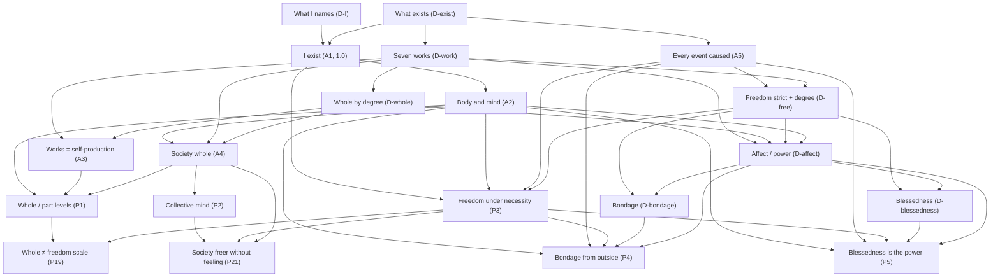

# Live chain — core v3

## BASE (locked seed-spine)

**LOCKED.** The twenty entries below are the frozen seed-spine. Snapshot: [BASE.md](BASE.md).

Do not rewrite the BASE without author reopen. Grow *from* it (expansion folders / later sections). Human titles first; machine ids secondary.

**Locked 2026-10-24 Pacific (America/Los_Angeles).** Count **20**. Only A1 scored (1.0). Prior prune + hyper-connect commit `1bb64bf`; volume park stays in [PARKED_VOLUME/](PARKED_VOLUME/).

Times are Pacific (America/Los_Angeles).

---

## Full BASE set

**Count: 20 BASE entries.**

| # | Title | Id | Kind | Statement (one line) | Confidence | Cites |
|---|---|---|---|---|---|---|
| 1 | [What "I" names](D-I.md) | D-I | definition | "I", used in a thought, names the thinker of that thought, if there is a thinker distinct from the thinking, and otherwise the thinking itself. | (definition; unscored) | — |
| 2 | [What exists](D-exist.md) | D-exist | definition | An activity exists at a time when it is going on at that time; lasting is going on existing. | (definition; unscored) | — |
| 3 | [I exist](A1.md) | A1 | root | I exist. | 1.0 | — |
| 4 | [A human body, and its mind](A2.md) | A2 | axiom, empirical | I am a human body made of cells, and my mind is that same body's organization described in the first person. | pending (collider) | A1 |
| 5 | [Work, and the seven works](D-work.md) | D-work | definition | A work helps keep an organization going; seven works named by test; "as one" by the take-apart test. | (definition; unscored) | — |
| 6 | [Whole, degree, member, level, self-production, sameness](D-whole.md) | D-whole | definition | Grade each work 0/1/2; degree = lowest; whole if degree > 0; member; level; self-production; same whole later. | (definition; unscored) | — |
| 7 | [The seven works sort things the way self-production does](A3.md) | A3 | axiom, model | Self-producers perform all seven works as one; non-producers fail at least one. | pending (collider) | — |
| 8 | [The society I live in is a whole to a degree](A4.md) | A4 | axiom, model | The society I live in is a whole to a degree, judged one work at a time; I am one of its members. | pending (collider) | A2 |
| 9 | [A whole at one level, a part at the next](P1.md) | P1 | proposition | I am a whole at one level and a part at the next. | pending (collider) | A2, A3, A4 |
| 10 | [A collective mind happens](P2.md) | P2 | proposition | Collective mind = control as one with signaling and memory; activity, not a claim that society feels. | pending (collider) | A4 |
| 11 | [Every event is caused](A5.md) | A5 | axiom, model | Every event is caused, a choice included. | pending (collider) | — |
| 12 | [Freedom, strict and by degree](D-free.md) | D-free | definition | Strict: from own nature alone (Nature). Degree: from own organization + clear knowledge of causes. | (definition; unscored) | — |
| 13 | [Freedom by degrees under necessity](P3.md) | P3 | proposition | Degree-freedom is compatible with every event being caused; freer as action follows from own organization and clear knowledge of causes. | pending (collider) | A1, A2, A5 |
| 14 | [Affect, and change of power](D-affect.md) | D-affect | definition | An affect is a change in power of acting (= degree of the works), with the ideas of that change. | (definition; unscored) | — |
| 15 | [Bondage](D-bondage.md) | D-bondage | definition | Bondage = acting from outside causes or from affects whose causes are unclear; inverse of degree-freedom. | (definition; unscored) | — |
| 16 | [Blessedness](D-blessedness.md) | D-blessedness | definition | Blessedness = power of acting as it rises with degree-freedom; not a reward afterward. | (definition; unscored) | — |
| 17 | [Bondage is acting from what is outside](P4.md) | P4 | proposition | A finite agent is in bondage to the degree its action follows from outside causes or unclear affects. | pending (collider) | A2, A5, P3 |
| 18 | [Blessedness is the power itself](P5.md) | P5 | proposition | Blessedness is not a reward after freedom, but the power of acting itself as freedom rises. | pending (collider) | A2, A5, P3 |
| 19 | [Degree of whole tracks degree of freedom only loosely](P19.md) | P19 | proposition | Whole-degree and freedom-degree are related but not the same scale. | pending (collider) | P1, P3 |
| 20 | [Society can be freer without feeling](P21.md) | P21 | proposition | Society can rise in degree-freedom without corporate feeling (conjecture-grade). | pending (collider) | P2, P3, A4 |

## Caps (effective confidence)

| Entry | Cap rule |
|---|---|
| A1 | 1.0 |
| A2 | own score of clause (a); A1 caps nothing |
| A3 | own score (cites nothing) |
| A4 | min(weakest work-row, A2) |
| P1 | min(A2, A3, A4) |
| P2 | min(A4 control/signaling/memory, A2 via A4) |
| A5 | own score |
| P3 | min(A2, A5) |
| P4 | min(A2, A5, P3) |
| P5 | min(A2, A5, P3) |
| P19 | min(P1, P3) |
| P21 | min(P2, P3, A4); conjecture-grade |
| D-* | definitions add nothing |

## Dependency graph

Every kept entry rests on and points to its supports (see each file's **Hyper-connect** block).



### Cap chains (load-bearing)

```
A1 (1.0)
 └── A2 (own)
      ├── A4 = min(rows, A2)
      │    ├── P1 = min(A2, A3, A4)
      │    │    └── P19 = min(P1, P3)
      │    ├── P2 = min(A4 rows, A2)
      │    │    └── P21 = min(P2, P3, A4)  [conjecture]
      │    └── …
      └── P3 = min(A2, A5)
           ├── P4 = min(A2, A5, P3)
           ├── P5 = min(A2, A5, P3)
           ├── P19 = min(P1, P3)
           └── P21 = min(P2, P3, A4)
A3 (own) ──► P1
A5 (own) ──► P3, P4, P5
```

## Groups (live)

1. **The I** — #1–4 — seed + body/mind
2. **Wholes** — #5–8 — works, degree, self-production, society
3. **Levels** — #9–10 — P1, P2
4. **Freedom under necessity** — #11–13 — A5, D-free, P3
5. **Affect, bondage, blessedness** — #14–18 — D-affect, defs, P4, P5
6. **Original bridges** — #19–20 — P19 (scales), P21 (collective freedom without feeling)

## Seed

*I exist* (A1), *What "I" names* (D-I), *What exists* (D-exist). Saved 2026-10-23 PT; pushed as `f52911c`.

## Parked volume

72 entries from the volume-expansion pass live under [PARKED_VOLUME/](PARKED_VOLUME/) with index [PARKED_VOLUME/INDEX.md](PARKED_VOLUME/INDEX.md). Not deleted. See also [PARKED.md](PARKED.md).

## Related

- [README.md](README.md)
- [BUILD_LOG.md](BUILD_LOG.md)
- [DEPS.md](DEPS.md) — live dependency index
- [CAPS.md](CAPS.md) — cap rules
- [tools/dep_check.py](tools/dep_check.py) — checker
- [SPINOZA_GROUND.md](SPINOZA_GROUND.md) — map still useful; most Part I–V apparatus now parked

---

## Expansion from BASE (kilned strongest half)

**Not BASE.** Grown from the locked twenty, then kilned.

**Live expansion: 122** in [expansion/](expansion/). Full table: [expansion/INDEX.md](expansion/INDEX.md).
**Parked this kiln: 126** → [expansion/PARKED/](expansion/PARKED/). Snapshot: [KILNED.md](KILNED.md).

BASE stays locked. PARKED_VOLUME (72) stays parked unless re-grown with BASE cites.

### Groups (live after kiln)

| Group | Path | Live |
|---|---|---|
| Body and mind | [expansion/body_mind/](expansion/body_mind/) | 10 |
| Wholes and works | [expansion/wholes/](expansion/wholes/) | 16 |
| Society and collective mind | [expansion/society/](expansion/society/) | 8 |
| Necessity and freedom | [expansion/necessity_freedom/](expansion/necessity_freedom/) | 12 |
| Affects and end | [expansion/affects_end/](expansion/affects_end/) | 7 |
| Nature and knowledge | [expansion/nature_knowledge/](expansion/nature_knowledge/) | 6 |
| Bridges | [expansion/bridges/](expansion/bridges/) | 10 |
| Politics and ethics | [expansion/politics_ethics/](expansion/politics_ethics/) | 5 |
| Method | [expansion/method/](expansion/method/) | 5 |
| Time and identity | [expansion/time_identity/](expansion/time_identity/) | 4 |
| Edge cases | [expansion/edge_cases/](expansion/edge_cases/) | 6 |
| Language and communication | [expansion/language_comm/](expansion/language_comm/) | 3 |
| Economy and tech | [expansion/economy_tech/](expansion/economy_tech/) | 4 |
| More affects | [expansion/affects_more/](expansion/affects_more/) | 3 |
| Practices | [expansion/practices/](expansion/practices/) | 3 |
| Conflict and peace | [expansion/conflict_peace/](expansion/conflict_peace/) | 4 |
| Error and illusion | [expansion/error_illusion/](expansion/error_illusion/) | 4 |
| Digital mind | [expansion/digital_mind/](expansion/digital_mind/) | 5 |
| Cosmology and value | [expansion/cosmology_value/](expansion/cosmology_value/) | 3 |
| Biology deep | [expansion/biology_deep/](expansion/biology_deep/) | 4 |

**Totals:** BASE **20** locked + live expansion **122** = **142** in play (parks separate).

**Dependency management:** run `python3 tools/dep_check.py` (stdlib). Full reverse index: [DEPS.md](DEPS.md). Caps: [CAPS.md](CAPS.md).

### Sample spine → expansion

```
BASE A2 → body_mind, edge_cases, biology_deep, digital_mind, time_identity
BASE A3/D-whole → wholes (weakest-work, take-apart, tumor, machine)
BASE A4/P2/P21 → society, bridges, conflict_peace, economy_tech
BASE A5/P3 → necessity_freedom, error_illusion, practices
BASE D-affect/P5 → affects_end (core), few affects_more
BASE P19/P21 → bridges (cult / military / AI / open science)
```

### Expansion dependency sketch (load-bearing)

```mermaid
graph TD
  A2["A human body, and its mind (A2)"]
  A3["The seven works sort things the way self-production does (A3)"]
  A4["The society I live in is a whole to a degree (A4)"]
  A5["Every event is caused (A5)"]
  P2["A collective mind happens (P2)"]
  P3["Freedom by degrees under necessity (P3)"]
  P4["Bondage is acting from what is outside (P4)"]
  P19["Degree of whole tracks degree of freedom only loosely (P19)"]
  P21["Society can be freer without feeling (P21)"]
  Pweakestworkrules["The weakest work sets the degree (P-weakest-work-rules)"]
  Ptakeaparttest["Take-apart test for as-one (P-take-apart-test)"]
  Ptumoredge["A tumor is a whole that harms the higher… (P-tumor-edge)"]
  Pmachinenotselfproducer["Most machines fail at least one work as … (P-machine-not-self-producer)"]
  Pcorporationwithoutfeeling["A corporation can act freer without feel… (P-corporation-without-feeling)"]
  Ppropagandabondage["Propaganda is bondage at society scale (P-propaganda-bondage)"]
  Plawasmemory["Law is public memory with teeth (P-law-as-memory)"]
  Pcollectivefreedomrises["Clear shared knowledge can raise collect… (P-collective-freedom-rises)"]
  Pchoicecaused["A choice is an event and so caused (P-choice-caused)"]
  Pfreerknowsmorecauses["Freer action tracks clearer cause-maps (P-freer-knows-more-causes)"]
  Phabitcanbond["Habit can be bondage or stored freedom (P-habit-can-bond)"]
  Dclearknowledge["Clear knowledge of causes (D-clear-knowledge)"]
  Pcultbondage["A cult can be a tight whole in bondage (P-cult-bondage)"]
  Pmilitarywhole["A military unit can be high-degree, mixe… (P-military-whole)"]
  Paicollective["AI collectives can be wholes without fee… (P-ai-collective)"]
  Popensciencesociety["Open science societies can rise on both … (P-open-science-society)"]
  Pstrongwholelowfreedom["A strong whole can still be unfree (P-strong-whole-low-freedom)"]
  Pweakwholehighfreedom["A fragile whole can still be freer (P-weak-whole-high-freedom)"]
  Psplitbrain["Split brain challenges unity of first pe… (P-split-brain)"]
  PdigitalA1["A digital system can utter A1; certainty… (P-digital-A1)"]
  PcopynotA1transfer["Copying a pattern does not transfer this… (P-copy-not-A1-transfer)"]
  OPfeeling["Why anything is felt stays open (OP-feeling)"]
  Papparentcontingency["Apparent contingency is incomplete knowl… (P-apparent-contingency)"]
  Ptitleclaim["Freedom of necessity is degree-freedom u… (P-title-claim)"]
  Pactivevspassive["Active affects follow from clearer causes (P-active-vs-passive)"]
  Pblessednessnotafterlife["Blessedness is not an afterlife payment (P-blessedness-not-afterlife)"]
  Pvirtueispower["Virtue is living from power of acting (P-virtue-is-power)"]
  Dcompassion["Compassion (D-compassion)"]
  Pangercanrepair["Anger can feed repair or bondage (P-anger-can-repair)"]
  Pcompassionfreedom["Compassion can raise joint freedom (P-compassion-freedom)"]
  Pcancerdefection["Cancer is member defection into a rival … (P-cancer-defection)"]
  Pevolution["Evolution is population-level transform … (P-evolution)"]
  Ppain["Pain signals threat to works (P-pain)"]
  Dbrain["Brain as control gear of the body (D-brain)"]
  Pinjurylowersdegree["Injury can lower whole-degree and freedo… (P-injury-lowers-degree)"]
  Potherbodies["Other human bodies exist on evidence (P-other-bodies)"]
  Probotmember["A robot can be a member without being a … (P-robot-member)"]
  Dwar["War as organized harm between wholes (D-war)"]
  Pcivilwar["Civil war splits one society-whole (P-civil-war)"]
  OPwhyanything["Why anything exists at all stays open (OP-why-anything)"]
  A3 --> Pweakestworkrules
  A3 --> Ptakeaparttest
  A3 --> Ptumoredge
  A2 --> Ptumoredge
  A3 --> Pmachinenotselfproducer
  P21 --> Pcorporationwithoutfeeling
  P2 --> Pcorporationwithoutfeeling
  A4 --> Pcorporationwithoutfeeling
  P4 --> Ppropagandabondage
  P2 --> Ppropagandabondage
  P21 --> Ppropagandabondage
  P2 --> Plawasmemory
  A4 --> Plawasmemory
  P21 --> Pcollectivefreedomrises
  P3 --> Pcollectivefreedomrises
  P2 --> Pcollectivefreedomrises
  A5 --> Pchoicecaused
  A2 --> Pchoicecaused
  P3 --> Pchoicecaused
  P3 --> Pfreerknowsmorecauses
  Dclearknowledge --> Pfreerknowsmorecauses
  P3 --> Phabitcanbond
  P4 --> Phabitcanbond
  P3 --> Dclearknowledge
  A2 --> Dclearknowledge
  P19 --> Pcultbondage
  P4 --> Pcultbondage
  P2 --> Pcultbondage
  P19 --> Pmilitarywhole
  A4 --> Pmilitarywhole
  P3 --> Pmilitarywhole
  P2 --> Paicollective
  P21 --> Paicollective
  OPfeeling --> Paicollective
  P19 --> Popensciencesociety
  P21 --> Popensciencesociety
  P19 --> Pstrongwholelowfreedom
  P3 --> Pstrongwholelowfreedom
  P4 --> Pstrongwholelowfreedom
  P19 --> Pweakwholehighfreedom
  P3 --> Pweakwholehighfreedom
  A4 --> Pweakwholehighfreedom
  A2 --> Psplitbrain
  OPfeeling --> Psplitbrain
  A2 --> PdigitalA1
  Potherbodies --> PcopynotA1transfer
  PdigitalA1 --> PcopynotA1transfer
  A2 --> OPfeeling
  A5 --> Papparentcontingency
  Dclearknowledge --> Papparentcontingency
  P3 --> Ptitleclaim
  A5 --> Ptitleclaim
  P3 --> Pactivevspassive
  P4 --> Pactivevspassive
  P3 --> Pvirtueispower
  P4 --> Dcompassion
  P4 --> Pangercanrepair
  P3 --> Pangercanrepair
  Dcompassion --> Pcompassionfreedom
  P21 --> Pcompassionfreedom
  Ptumoredge --> Pcancerdefection
  A3 --> Pcancerdefection
  A3 --> Pevolution
  A5 --> Pevolution
  P4 --> Ppain
  A2 --> Dbrain
  P2 --> Dbrain
  A2 --> Pinjurylowersdegree
  P3 --> Pinjurylowersdegree
  P19 --> Pinjurylowersdegree
  A2 --> Potherbodies
  A3 --> Probotmember
  A4 --> Probotmember
  A4 --> Dwar
  P2 --> Dwar
  Dwar --> Pcivilwar
  A4 --> Pcivilwar
  P2 --> Pcivilwar
  A2 --> A4
  A4 --> P2
  A5 --> P3
  P3 --> P4
  P3 --> P19
  P2 --> P21
  P3 --> P21
  A3 --> P19
```


