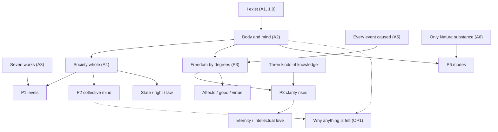

# Core v3 (candidate): restart from "I exist" alone

**Status: candidate only.** Nothing here is in `entries/`. Nothing here has been promoted. Core v2 stays untouched at [candidates/core_v2/](../core_v2/) and in `entries/` until the author says otherwise.

**Restart (2026-10-23 PT).** At the author's word: **I exist** is the only root axiom. The chain is rebuilt from the seed outward. Definitions needed to ground claims stay ahead of the claims that use them.

**Volume expansion (2026-10-24 PT).** Author: worry less about accuracy; expand as much as possible. Live set jumped from **19 → 92** entries covering remaining Spinoza ground (substance/modes, kinds of knowledge, affects, good/bad, politics, eternity) plus consciousness/levels/causality variants from this seed. Scores stay pending/rough except A1.

**Labels.** Each entry has a human title first. Machine ids stay in front matter and filenames. In tables below, read the title column; the id is secondary.

**Chain file.** Full table with confidence and cites: [CHAIN.md](CHAIN.md) (92 rows). Spinoza map: [SPINOZA_GROUND.md](SPINOZA_GROUND.md).

## The seed

*I exist* (A1), *What "I" names* (D-I), *What exists* (D-exist). Saved as the seed at the author's word (2026-10-23 PT); pushed as `f52911c`.

## Live chain — groups

| Group | Span | Theme |
|---|---|---|
| 1 | #1–4 | The I (seed + body/mind) |
| 2 | #5–8 | Wholes (works, degree, self-production, PR1) |
| 3 | #9–12 | Nature, society, levels |
| 4 | #13–15 | Freedom under necessity |
| 5 | #16–19 | Strive, affect, bondage, blessedness |
| 6 | #20–26 | Substance, attribute, mode |
| 7 | #27–32 | Causality variants |
| 8 | #33–46 | Ideas and kinds of knowledge |
| 9 | #47–66 | Named affects |
| 10 | #67–75 | Good, bad, virtue |
| 11 | #76–82 | Politics and the state |
| 12 | #83–86 | Eternity of mind |
| 13 | #87–92 | Consciousness, levels, open problems |

Full one-line statements, cites, and caps: **[CHAIN.md](CHAIN.md)**.

### Group 1 — the I (seed)

| # | Title | Id | Kind | Rests on |
|---|---|---|---|---|
| 1 | [What "I" names](D-I.md) | D-I | definition | (definition) |
| 2 | [What exists](D-exist.md) | D-exist | definition | (definition) |
| 3 | [I exist](A1.md) | A1 | root, **1.0** | nothing: doubting it is a case of it |
| 4 | [A human body, and its mind](A2.md) | A2 | axiom, empirical, **pending** | A1 + own evidence; identity declared |

### Skeleton after the seed (load-bearing claims)

| Title | Id | Role |
|---|---|---|
| [The seven works sort things the way self-production does](A3.md) | A3 | wholes hinge |
| [The society I live in is a whole to a degree](A4.md) | A4 | society hinge |
| [Every event is caused](A5.md) | A5 | necessity |
| [Freedom by degrees under necessity](P3.md) | P3 | title claim |
| [Only Nature answers to substance](A6.md) | A6 | Part I uniqueness (model) |
| [Three kinds of knowledge](D-knowledge.md) | D-knowledge | knowledge ladder |
| [Good](D-good.md) / [Virtue as power](D-virtue.md) | D-good, D-virtue | Part IV |
| [The state](D-state.md) / [The political order is a whole to a degree](A8.md) | D-state, A8 | politics |
| [Mind under the aspect of eternity](P16.md) | P16 | Part V candidate |
| [Why anything is felt](OP1.md) | OP1 | hard problem (open) |

**Caps (summary).** A1 = 1.0. Definitions and PR1/PR2 add nothing. OP1 unscored. Load-bearing caps: see [CHAIN.md](CHAIN.md). Most new axioms/props pending collider.

## Rules for this restart

1. **Root:** *I exist* (A1) at 1.0.
2. **One chain.** No split tracks. Declared readings stay inside their entries and are unscored.
3. **Scores pending** until the collider runs (except A1).
4. **Extend from this seed.** Spinoza's ground is covered by extending outward, not by copying the *Ethics* part-order as axioms.
5. **Volume over polish** when the author says so (2026-10-24 PT pass).
6. **Not pushed** for rebuild steps after the seed unless the author says so.

## What this chain does not yet settle

- Why anything is felt (**OP1** open; A2/P2 limits).
- Full scored Part I geometric sequence (only A6 model uniqueness).
- Complete infinite-mode physics; every emotion as its own scored file (catalog covers the rest).
- Best political constitution; personal immortality in duration (P16 denies lasting-forever claim).
- Promotion into `entries/` (needs a separate author OK).
- Collider numbers for A5–A9 and P3–P21.

## Logs

- [CHAIN.md](CHAIN.md)
- [SPINOZA_GROUND.md](SPINOZA_GROUND.md)
- [BUILD_LOG.md](BUILD_LOG.md)
- [PARKED.md](PARKED.md)
- [notes/2026-10-23-core-v3-restart.md](../../notes/2026-10-23-core-v3-restart.md)
- [notes/2026-10-23-core-v3-chain-and-spinoza-ground.md](../../notes/2026-10-23-core-v3-chain-and-spinoza-ground.md)
