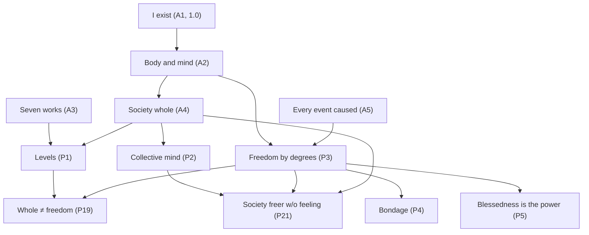

# Core v3 (candidate): pruned live chain from "I exist"

**Status: candidate only.** Nothing here is in `entries/`. Nothing here has been promoted. Core v2 stays untouched at [candidates/core_v2/](../core_v2/) and in `entries/` until the author says otherwise.

**Restart (2026-10-23 PT).** At the author's word: **I exist** is the only root axiom. The chain is rebuilt from the seed outward.

**Volume then prune (2026-10-24 PT).** Expanded to 92 covering Spinoza's ground; kilned; then **pruned to the strongest 20** and hyper-connected. The other **72** live under [PARKED_VOLUME/](PARKED_VOLUME/) — not deleted.

**Labels.** Human title first; machine id secondary (front matter and filenames).

**Chain file.** Full table, caps, and dependency graph: [CHAIN.md](CHAIN.md) (**20** rows).

## The seed

*I exist* (A1), *What "I" names* (D-I), *What exists* (D-exist). Saved as the seed at the author's word (2026-10-23 PT); pushed as `f52911c`.

## Live chain — 20 load-bearing entries

| # | Title | Id | Role |
|---|---|---|---|
| 1 | [What "I" names](D-I.md) | D-I | definition |
| 2 | [What exists](D-exist.md) | D-exist | definition |
| 3 | [I exist](A1.md) | A1 | root, **1.0** |
| 4 | [A human body, and its mind](A2.md) | A2 | empirical hinge |
| 5 | [Work, and the seven works](D-work.md) | D-work | wholes vocabulary |
| 6 | [Whole, degree, member, level, self-production, sameness](D-whole.md) | D-whole | degree measure |
| 7 | [The seven works sort things the way self-production does](A3.md) | A3 | wholes hinge |
| 8 | [The society I live in is a whole to a degree](A4.md) | A4 | society hinge |
| 9 | [A whole at one level, a part at the next](P1.md) | P1 | levels |
| 10 | [A collective mind happens](P2.md) | P2 | collective control (no feeling claim) |
| 11 | [Every event is caused](A5.md) | A5 | necessity |
| 12 | [Freedom, strict and by degree](D-free.md) | D-free | two senses of free |
| 13 | [Freedom by degrees under necessity](P3.md) | P3 | title claim |
| 14 | [Affect, and change of power](D-affect.md) | D-affect | power / affect |
| 15 | [Bondage](D-bondage.md) | D-bondage | word for the downward degree |
| 16 | [Blessedness](D-blessedness.md) | D-blessedness | word for the upward end |
| 17 | [Bondage is acting from what is outside](P4.md) | P4 | inverse of degree-freedom |
| 18 | [Blessedness is the power itself](P5.md) | P5 | power, not a reward |
| 19 | [Degree of whole tracks degree of freedom only loosely](P19.md) | P19 | anti-collapse bridge |
| 20 | [Society can be freer without feeling](P21.md) | P21 | conjecture-grade collective freedom |

**Caps (summary).** A1 = 1.0. Definitions add nothing. Load-bearing: P1 = min(A2,A3,A4); P3 = min(A2,A5); P4/P5 = min(A2,A5,P3); P19 = min(P1,P3); P21 = min(P2,P3,A4) conjecture-grade. Full table: [CHAIN.md](CHAIN.md).

Each live file has a **Hyper-connect** block: Rests on / Supports / Cap.

## Rules for this restart

1. **Root:** *I exist* (A1) at 1.0.
2. **One chain.** No split tracks. Declared readings stay inside their entries and are unscored.
3. **Scores pending** until the collider runs (except A1).
4. **Extend from this seed.** Spinoza's ground is covered by extending outward, not by copying the *Ethics* part-order as axioms.
5. **Volume over polish** when the author says so — then **prune to strongest** when asked (2026-10-24 PT).
6. **Park, don't delete.** Soft or catalog volume goes to [PARKED_VOLUME/](PARKED_VOLUME/).
7. **Not pushed** for rebuild/prune steps after the seed unless the author says so.
8. **Kiln** hardens coherence; **prune** shrinks to hinges; **hyper-connect** makes every kept entry rest on and point to its supports.

## What this chain does not yet settle

- Why anything is felt (open; parked as OP1).
- Full Part I geometric sequence; named-affect catalog; politics; eternity (parked volume).
- Promotion into `entries/` (needs a separate author OK).
- Collider numbers for A2–A5 and P1–P5, P19, P21.

## Logs

- [CHAIN.md](CHAIN.md)
- [PARKED.md](PARKED.md) / [PARKED_VOLUME/INDEX.md](PARKED_VOLUME/INDEX.md)
- [BUILD_LOG.md](BUILD_LOG.md)
- [SPINOZA_GROUND.md](SPINOZA_GROUND.md)
