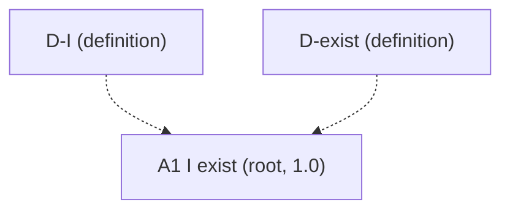

# Core v3 (candidate): restart from "I exist" alone

**Status: candidate only.** Nothing here is in `entries/`. Nothing here has been promoted. Core v2 stays untouched at [candidates/core_v2/](../core_v2/) and in `entries/` until the author says otherwise.

**Restart (2026-10-23 PT).** At the author's word: **A1 = I exist. That is the only axiom now.** Everything else on the old axiom and proposition list is retired from this chain and will be rebuilt. Definitions needed to ground A1's two words stay.

## Live chain

| # | Entry | Kind | Statement (one line) | Rests on |
|---|---|---|---|---|
| 1 | [D-I](D-I.md) | definition | "I", used in a thought, names the thinker of that thought, if there is a thinker distinct from the thinking, and otherwise the thinking itself. | (definition) |
| 2 | [D-exist](D-exist.md) | definition | An activity exists at a time when it is going on at that time; for anything else "exists" is taken as understood; a thing lasts when it goes on existing (duration, E2D5). | (definition) |
| 3 | [A1](A1.md) | root, **1.0** | I exist. (In defined terms: this thinking is going on now, and so its thinker, if it has one distinct from it, exists now.) | nothing: doubting it is a case of it; uses D-I, D-exist |

## Rules for this restart

1. **Only axiom:** A1 "I exist" at confidence 1.0.
2. **Definitions kept only to ground A1's terms:** D-I ("I") and D-exist ("exist"). They carry no confidence.
3. **Parked, not deleted:** A2, A3, A4, PR1, P1, P2, D-work, D-whole, D-Nature, and the freedom candidates (A5, D-free, P3). See [PARKED.md](PARKED.md). The core v2 files and `entries/` copies are the archive.
4. **No rewrite of A1's root wording.** Surrounding text was trimmed of forward cites to the retired chain so this folder is coherent on its own.
5. **Not pushed** until the author says so. Local commit only.

## What this does not yet settle

A1 says that I exist and nothing about what I am. The next claim after A1 is open. Body, mind, Nature, wholes, society, freedom: all wait to be rebuilt, if they return at all.

## Logs

- [BUILD_LOG.md](BUILD_LOG.md) — this restart.
- [notes/2026-10-23-core-v3-restart.md](../../notes/2026-10-23-core-v3-restart.md) — dated note for the author.
